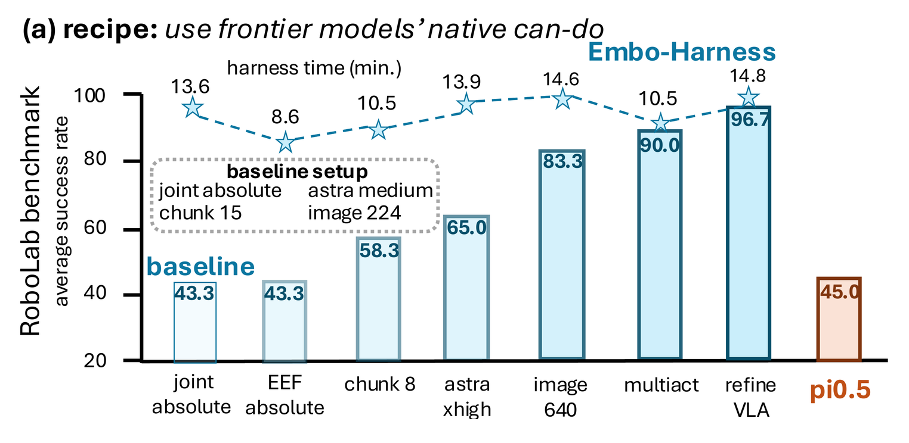
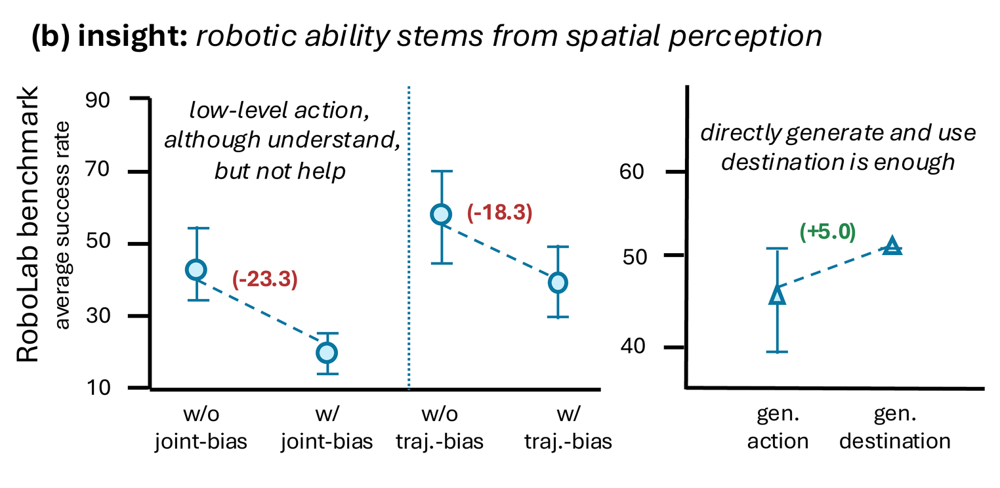
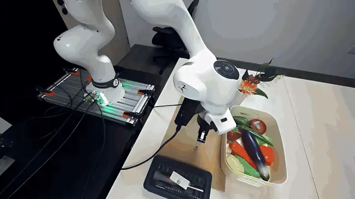
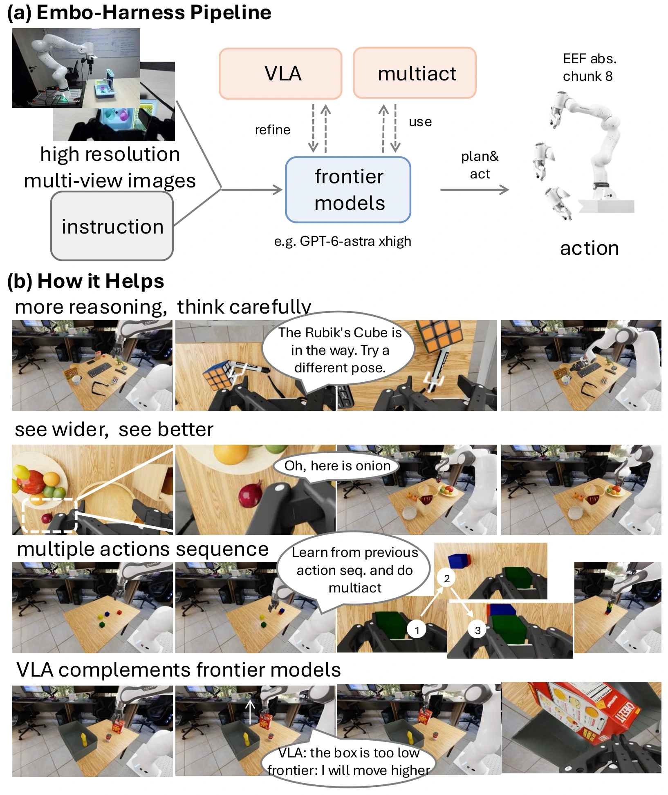
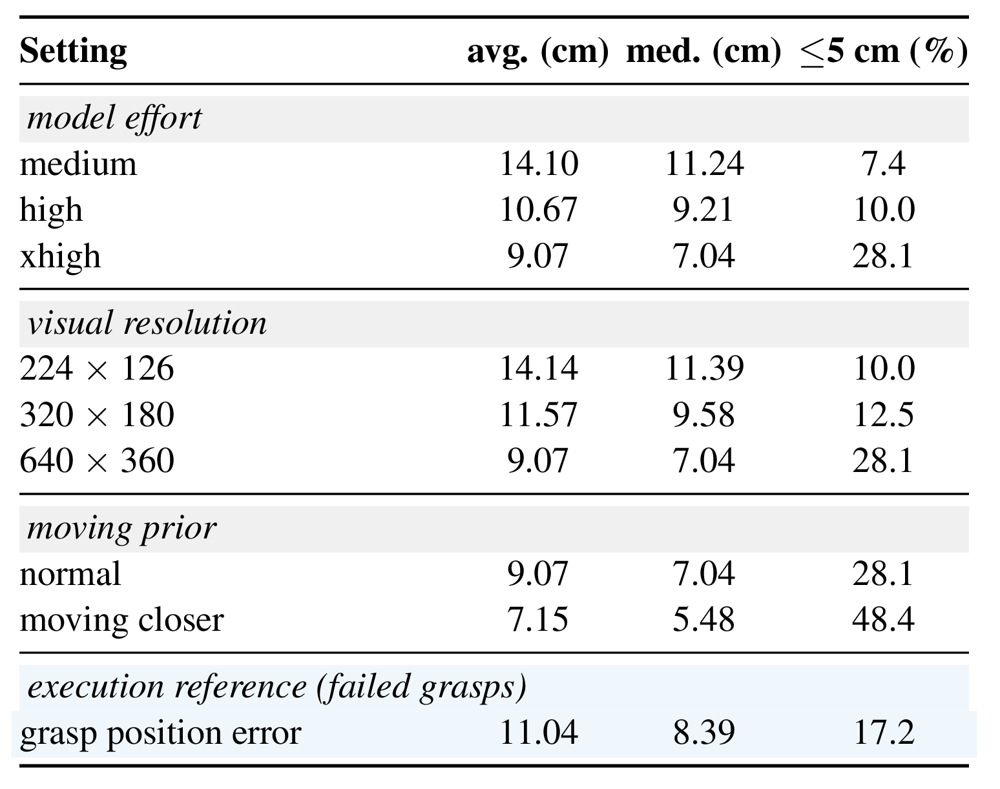

# Embo-Harness: Towards Understanding Frontier-Model-as-Policy Harness

[](https://arxiv.org/abs/2611.31201)
[](https://dravenalg.github.io/projects/Embo-Harness/)

**Embo-Harness** studies how frontier models can serve directly as robot policies, through two questions:

**How can we design a harness to unlock their robotic capabilities?**<br>
Align prompting, planning, action execution, and tool use with the **model's native capabilities**. Our practical recipe achieves **83.3% success on RoboLab-120** and **15/20 zero-shot real-world successes**.

<p align="center">
  
  <br>
  <sub>Harness design on the 20-task exploration subset.</sub>
</p>

**Why do frontier models perform so well in robotics?**<br>
Controlled experiments highlight **accurate spatial target estimation**: predicting end-effector destinations outperforms short-range action generation, while requiring explicit joint-level or frame-wise generation reduces performance.

<p align="center">
  
  <br>
  <sub>Spatial perception and action-generation ablations on the 20-task exploration subset.</sub>
</p>

<p align="center">
  
</p>

## 🛠️ Environment Setup

The harness server requires Python 3.10 or newer. 

For GPT models, install the official [Codex CLI](https://developers.openai.com/codex/cli). The Codex harness requires Linux with working sandbox support and has been tested with CLI 0.168.0, 0.171.0.
```bash
npm install -g @openai/codex@0.168.0 # npm install -g @openai/codex@0.171.0
```

Clone the repository with its RoboLab submodule:

```bash
git clone https://github.com/DravenALG/Embo-Harness.git
cd Embo-Harness
git submodule update --init third_party/RoboLab # needs git lfs to download assets
# run ‘git -C third_party/RoboLab lfs pull’ after download
git submodule update --init third_party/openpi
```

Install the required packages:
```bash
conda create -n embo python=3.10
conda activate embo
python -m pip install -r requirements.txt
```

Setup the environmrnt for RoboLab:
```bash
cd third_party/RoboLab
# if not setup system package, install them
apt install -y ffmpeg libxt6 libglu1-mesa git-lfs
# download the scene, object, and robot assets stored in Git LFS
git lfs install --local
git lfs pull
# if not install uv, install it
curl -LsSf https://astral.sh/uv/install.sh | sh
source ~/.bashrc
# setup RoboLab venv
uv venv --python 3.11
source .venv/bin/activate
uv sync --extra isaac50
# setup openpi client (a general client)
uv pip install -e ../openpi/packages/openpi-client
cd ../.. # return to the repository root
```

Setup the environmrnt for PI (if you use PI to propose action):
```bash
# get into another terminal
cd third_party/openpi
GIT_LFS_SKIP_SMUDGE=1 uv sync
source .venv/bin/activate
GIT_LFS_SKIP_SMUDGE=1 uv pip install -e .
cd ../.. # return to the repository root
```


## 🤖 Run Embo-Harness

### The Recipe

<p align="center">
  
  <br>
  <sub><b>The recipe.</b> Embo-Harness pipeline and examples of how each design choice helps.</sub>
</p>

If using GPT, export OPENAI_API_KEY first.
```bash
export OPENAI_API_KEY="your_openai_api_key"
# export OPENAI_BASE_URL="" # if using a transfer station
```

The configuration in `config/harness/robolab.yaml` follows the paper's four
dimensions: prompting, planning, action execution, and tool use.

- **Prompting:** notice reminders, visual resolution, and third-person/wrist views.
- **Planning:** explicit or implicit planning, context management, and model reasoning effort.
- **Action execution:** action representation, fixed/adaptive chunking, and asynchronous execution.
- **Tool use:** short multi-action sequences, VLA selection, and VLA refinement.

#### Single Run

Then, start a single server for a simulator worker:
```bash
python scripts/serve_harness.py --config config/harness/robolab.yaml \
  --host 127.0.0.1 --port 8000
```

Then, in another terminal, run the client with RoboLab's Python environment:
```bash
third_party/RoboLab/.venv/bin/python third_party/RoboLab/policies/harness_policy/run.py \
  --task BananaInBowlTask --num-envs 1 --num-runs 3 --headless --device cuda:0 \
  --remote-host 127.0.0.1 --remote-port 8000 \
  --output-folder-name BananaInBowlTask_test
```

#### Batch Run

The RoboLab batch launcher starts server and client and run the assigned tasks on multiple GPUs:

```bash
BASE_PORT=8100 RUN_DIR=outputs/embo_harness/test  bash scripts/main_harness_robolab.sh \
 --config config/harness/robolab.yaml --gpus 0,1,2,3,4,5,6,7 --set sub --runs 3

# for resume, just add --resume
BASE_PORT=8100 RUN_DIR=outputs/embo_harness/test  bash scripts/main_harness_robolab.sh \
 --config config/harness/robolab.yaml --gpus 0,1,2,3,4,5,6,7 --set sub --runs 3 --resume

# for test, just add --dry-run
BASE_PORT=8100 RUN_DIR=outputs/embo_harness/test  bash scripts/main_harness_robolab.sh \
 --config config/harness/robolab.yaml --gpus 0,1,2,3,4,5,6,7 --set sub --runs 3 --dry-run
```

### The Insights

<p align="center">
  <a href="assets/spatial-estimation-table.png">
    
  </a>
  <br>
  <sub><b>Table 6.</b> Spatial position estimation and grasp execution errors on 20 RoboLab tasks, with three trials per task.</sub>
</p>

With `OPENAI_API_KEY` set, run the position estimation experiment from the repository root:

```bash
third_party/RoboLab/.venv/bin/python scripts/estimate_position.py \
  --model gpt-6-astra --effort xhigh --image-size 640 --set sub --num-runs 3
```

Add `--moving` to move the gripper toward the predicted target and estimate its position again.

## 📖 Reporting

Inspect batch progress, success rate, and mean costs for committed episodes with:

```bash
python scripts/report_harness_batch.py --run-dir outputs/embo_harness/<run> --gpus 0,1 --runs 1
```

Inspect individual episode statistics with:

```bash
python scripts/read_harness_results.py outputs/embo_harness/test
```


## 📚 Citation

If you find our work and code useful, or build on Embo-Harness, please also cite our paper.

```bibtex
@misc{wu2026_emboharness,
  title={Embo-Harness: Towards Understanding Frontier-Model-as-Policy Harness},
  author={Xiao-Ming Wu and Kang Liao and Yuexiao Ma and Taolin Zhang and Mingqian Zhou
          and Nuo Chen and Ziming Li and Yihang Luo and Rui Li and Zhonghua Wu and Tianyu Xie
          and Xiawu Zheng and Zhongang Cai and Zhi Hou and Chen Change Loy},
  year={2026},
  eprint={2611.31201},
  archivePrefix={arXiv},
  primaryClass={cs.RO},
  url={https://arxiv.org/abs/2611.31201},
}
```

## 🗞️ License

This project is licensed under [NTU S-Lab License 1.0](LICENSE).
